# TraceFix

TraceFix v0.1 is a local, single-attempt repair and evaluation pipeline for five seeded Python
benchmark repositories. It reproduces each failure, asks either a deterministic fake provider or
the explicitly selected Groq profile for a typed repair plan and patch, rejects unsafe proposals,
and verifies candidates in hardened Docker containers. It is an evaluation project, not a
production repair service, and it does not claim reliable repair of arbitrary repositories.

## Architecture

The current pipeline is synchronous and in memory:

```mermaid
flowchart LR
    A[Repository preparation] --> B[Baseline reproduction]
    B --> C[Failure classification]
    C --> D[Context selection]
    D --> E[Repair planning]
    E --> F[Patch generation]
    F --> G[Structured validation]
    G --> H[Unified-diff validation]
    H --> I[Plan / proposal / diff path agreement]
    I --> J[Patch policy]
    J --> K[Static checks]
    K --> L[Docker sandbox verification]
    L --> M[Candidate evaluation]
    M --> N[Run artifact / benchmark reports]
```



The eleven-node LangGraph combines the model-output validation steps within its planning and patch
generation nodes. Patch policy runs before a proposal is applied. Static validation applies an
approved patch to a fresh candidate and runs Python compilation, AST parsing, Ruff, strict mypy,
and Bandit in the `tracefix-static-checks:0.1.8` image. Functional verification then runs targeted,
complete-visible, and hidden tests in that order in the `tracefix-sandbox:0.1.3a` image. A static
pass alone is not a successful repair.

External systems are reached through typed adapters. Model prompts, responses, patches, test
output, hidden-test material, credentials, raw exceptions, and absolute host paths are excluded
from published artifacts and controlled diagnostics.

See the [system architecture](docs/architecture/tracefix-system-architecture.md) for the target
component model and trust boundaries.

## Requirements

- CPython `>=3.14,<3.15`; the repository and CI currently use Python 3.14.
- `pip` and the repository's `.venv` virtual environment.
- Docker with a usable Linux-container daemon and built-in seccomp support.

Docker is required to reproduce benchmark failures, run candidate static checks, verify candidates,
and execute the Docker integration/security suite. Ordinary source inspection and the Ruff, mypy,
and unit-test commands do not themselves start containers. Docker Desktop using Linux containers is
supported for Windows development, but Linux is the supported host for complete adversarial
filesystem guarantees.

## Installation and quick start

From the repository root in Windows PowerShell, with Python 3.14 selected:

```powershell
python -m venv .venv
.venv\Scripts\Activate.ps1
python -m pip install --editable ".[dev]"
docker build --tag tracefix-sandbox:0.1.3a --file docker/sandbox/Dockerfile .
docker build --tag tracefix-static-checks:0.1.8 --file docker/static-checks/Dockerfile .
python -B scripts/check.py
```

On POSIX systems, activate with `. .venv/bin/activate`; the remaining commands are the same. Reuse
the existing `.venv` after setup.

## Deterministic fake-model execution

The deterministic `tracefix-fake` provider is the normal safe way to validate the complete pipeline
locally and in CI. It has fixed project-owned responses for the five development cases, needs no
model credential, makes no provider network request, and produces repeatable repair evidence.

In PowerShell, run one case through the installed CLI:

```powershell
$env:MODEL_PROVIDER = "tracefix-fake"
$env:MODEL_NAME = "tracefix-deterministic-v1"
$env:MODEL_TEMPERATURE = "0"
$env:MODEL_MAX_TOKENS = "4096"
$env:PROMPT_VERSION = "repair-v1.0"
tracefix repair boundary_condition
```

Valid case IDs are:

- `boundary_condition`
- `exception_handling`
- `fixture_or_mocking`
- `incorrect_conditional`
- `incorrect_return_value`

The Docker-backed integration test runs all five cases through the installed command and real
pipeline:

```text
python -m pytest tests/integration/test_fake_model_cli.py
```

Each completed repair command writes a metadata-only artifact relative to the invocation directory:

```text
.tracefix/artifacts/<case_id>-<run_id>.json
```

Exit codes are `0` for success, `1` for candidate failure, `2` for CLI input errors, `3` for patch
policy rejection, `4` for static-check failure, `5` when the baseline is not reproducible, `6` for
infrastructure/publication failure, and `7` for malformed model output. Interruption exits `130`.

## Local checks

The canonical repository validation is:

```text
python -B scripts/check.py
```

It runs these supported checks in order:

```text
python -m ruff format --check .
python -m ruff check .
python -m mypy app benchmarks scripts
python -m pytest
```

Useful focused test commands are:

```text
python -m pytest tests/unit
python -m pytest tests/integration
```

Docker tests skip locally only when the Docker CLI or a usable Linux-container daemon is
unavailable. A release-gate result must come from an environment where both fixed images are built
and the applicable Docker tests actually run.

## Live Groq benchmark

The paid live benchmark is separate from installation, the quick start, deterministic CI, and the
fake-provider path. Do not run it without explicit authorization. It makes real provider requests
that may incur cost.

Install the live dependency and supply the exact supported profile plus reviewed current prices:

```powershell
python -m pip install --editable ".[dev,live]"
$env:MODEL_PROVIDER = "groq"
$env:MODEL_NAME = "openai/gpt-oss-120b"
$env:MODEL_TEMPERATURE = "0"
$env:MODEL_REASONING_EFFORT = "low"
$env:MODEL_MAX_TOKENS = "4096"
$env:PROMPT_VERSION = "repair-v1.0"
$env:MODEL_REQUEST_TIMEOUT_SECONDS = "120"
$env:MODEL_INPUT_PRICE_USD_PER_MILLION_TOKENS = "<reviewed current rate>"
$env:MODEL_OUTPUT_PRICE_USD_PER_MILLION_TOKENS = "<reviewed current rate>"
$env:GROQ_API_KEY = "<credential>"
tracefix benchmark --split development --provider groq
```

All five cases run sequentially and receive one repair attempt each. A shared pacer keeps real Groq
request starts at least 61 seconds apart across planning, patch generation, and case boundaries, so
the benchmark intentionally takes several minutes. Repair outcomes such as `candidate_failure`,
`policy_violation`, `static_check_failure`, or `malformed_model_output` are valid benchmark evidence;
the completed benchmark still exits `0`. Provider, platform, baseline, cleanup, artifact, or report
publication failure is classified separately as an execution failure, stops later paid work, and
exits `6`.

Each invocation publishes safe reports at:

```text
.tracefix/benchmarks/<benchmark_run_id>/report.json
.tracefix/benchmarks/<benchmark_run_id>/report.md
```

The reports record ordered outcomes and aggregate latency, provider-reported token usage, and
operator-rate-based estimated cost. They are evaluation evidence, not a provider invoice. The
per-case metadata-only artifacts remain under `.tracefix/artifacts/`.

The GitHub Actions workflow [`.github/workflows/live-benchmark.yml`](.github/workflows/live-benchmark.yml)
is independently triggered with **Actions → Live benchmark → Run workflow**. It has only a
`workflow_dispatch` trigger and is not a push or pull-request check. Its inputs select the fixed
development/Groq/model profile, timeout, and reviewed prices. Repository secrets `GROQ_API_KEY`
and `LANGSMITH_API_KEY` must be configured without exposing their values. The workflow enables only
TraceFix's controlled metadata-only LangSmith diagnostics and uploads the safe reports and per-case
artifacts.

### Latest authorized live evidence

GitHub Actions run `43335813246`, benchmark run
`b9dbf2b34cf749fab238885a8441fd54`, is a small five-case development benchmark:

- attempted: 5
- repair success: 1
- repair failure: 4
- execution failure: 0
- not run: 0
- exit code: 0

`exception_handling` completed patch-envelope validation, path agreement, patch policy, static
checks, sandbox verification, and evaluation. `boundary_condition`, `fixture_or_mocking`,
`incorrect_conditional`, and `incorrect_return_value` failed during unified-diff parsing. This 1/5
result is evidence about that one development run, not general model accuracy or production
readiness.

## Sandbox security

Untrusted benchmark and candidate code never executes directly on the host. Containers use no
network, a read-only root filesystem, numeric user/group `10001:10001`, dropped capabilities,
`no-new-privileges`, Docker's built-in seccomp profile, bounded CPU/memory/PIDs/time/output, and only
explicit temporary writable mounts. The repository and hidden-test bundle are mounted read-only;
the Docker socket, developer home, application/provider credentials, proxy settings, and host
secrets are not mounted or inherited. Protected and unsafe paths are rejected before execution.

The Docker daemon, container engine, project-owned images, and host administrator remain trusted.
See the [sandbox hardening specification](docs/specs/0.1-003c-security-hardening.md) for the detailed
boundary.

## Current limitations

- Exactly one repair attempt is made; there are no repair retries.
- State is in memory only: there is no persistence.
- Execution is synchronous: there is no queue or worker service.
- There is no GitHub integration.
- LangGraph has no checkpointer or checkpoint recovery.
- There is no production observability system. Controlled, metadata-only LangSmith diagnostics are
  available only for authorized live benchmark runs and do not expose prompts, repository source,
  model responses, patches/diffs, hidden tests, credentials, raw exceptions, or account identifiers.
- The benchmark contains only five small seeded development cases. In the latest authorized live
  run, four of five cases failed during unified-diff parsing.
- There is no API, provider/model comparison, statistical confidence interval, or claim that
  TraceFix reliably repairs arbitrary repositories.

Planned persistence, queues, API ingress, checkpoint recovery, GitHub integration, and production
observability are future work, not current functionality.

## Documentation

- [v0.1 release checklist](docs/release/v0.1-checklist.md)
- [implementation progress](docs/progress.md)
- [system architecture](docs/architecture/tracefix-system-architecture.md)
- [execution plan](docs/plan/tracefix-execution-plan.md)
- [task specifications](docs/specs/)
- [engineering and security rules](AGENTS.md)
